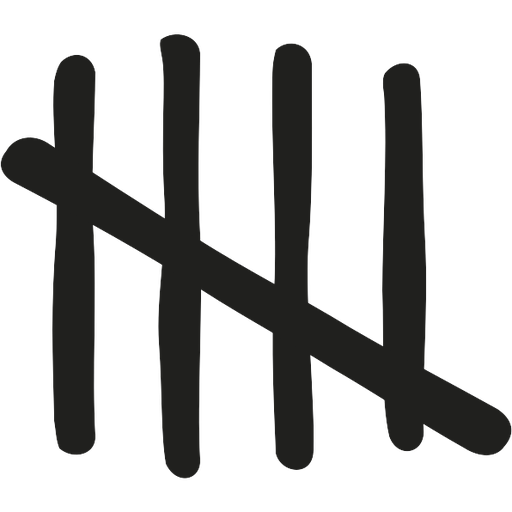
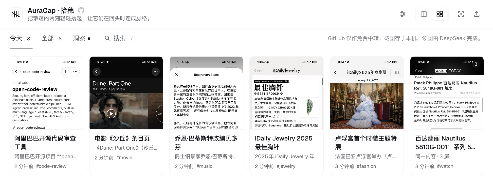
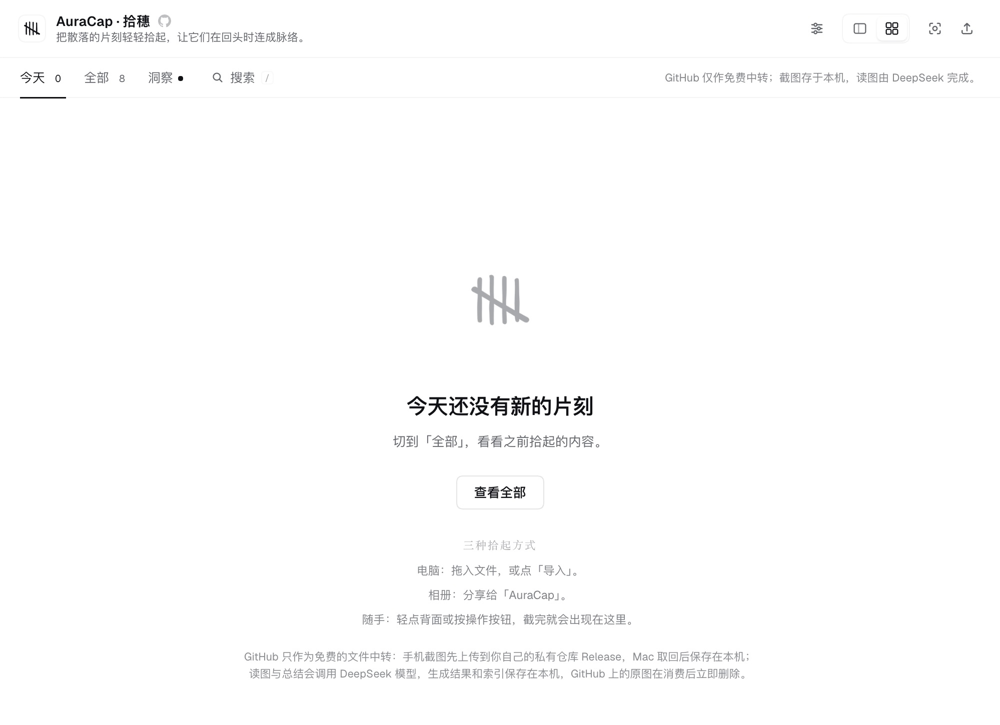
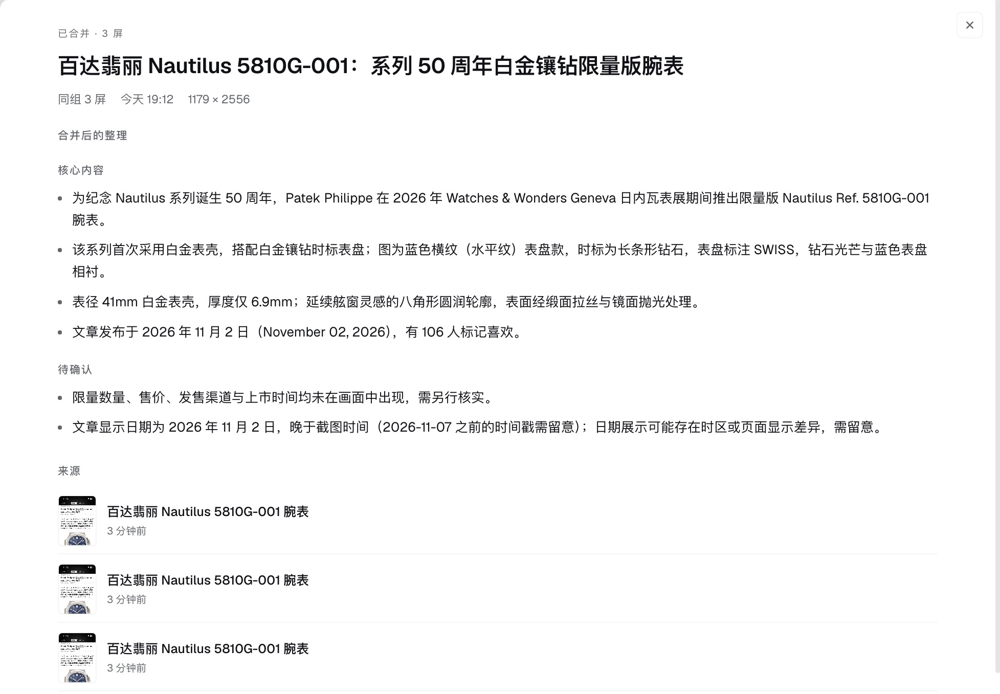
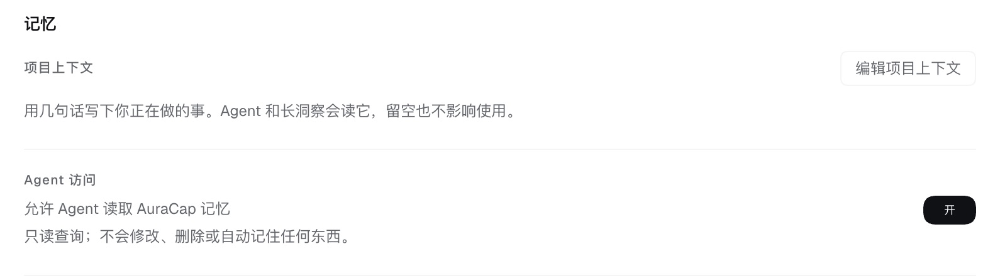
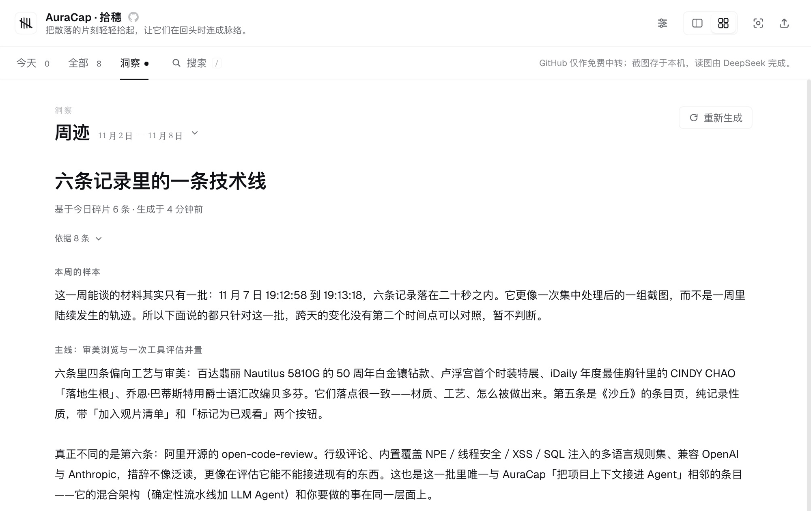

<p align="center">
  
</p>

<h1 align="center">AuraCap · Gleanings</h1>

<p align="center">
  <a href="README.md"><kbd>中文</kbd></a>
  &nbsp;
  <a href="README.en.md"><kbd>English</kbd></a>
</p>

<p align="center">
  <em>Gather the scattered moments; let them find their thread when you look back.</em>
</p>

<p align="center">
  A personal memory plugin that lives inside DeepSeek Harness.
</p>

<p align="center">
  
</p>

<p align="center">
  <sub>Moments gathered today, and a three-screen article kept together</sub>
</p>

## One thing

Every phone has a camera roll full of screenshots: a paragraph, an error message, a page saved for later.

They felt useful at the time. They rarely get opened again. Not because you don't want to look back, but because looking back is cumbersome: the image is in Photos, the understanding is in your head, and when you need either, neither is where you are.

AuraCap does one thing: **it keeps a screenshot findable after you gather it.**

## Where it came from

AuraCap did not start as a plugin.

It was a path from iPhone to GitHub: a Shortcut sent screenshots to a private Release, GitHub Actions picked them up, a model read them, and the result was written into Markdown files for the timeline, insights, and summaries.

The path worked, but it asked you to fork a repository, configure Actions, and understand Secrets. Capture became lighter; looking back was still somewhere else.

This version brings the second half home:

- the phone still uploads through a Shortcut;
- GitHub only carries the image from the phone to the Mac;
- image reading, summaries, search, and insights happen locally;
- capture and looking back finally share the same sidebar.

## Memory, right beside the conversation

AuraCap is not another knowledge base you have to remember to open.

Think of it as memory that lives beside the work, rather than in another app.

Imagine you are writing a small book about the city at night.

Over six months, you save things: an article about dark skies, a photograph from an exhibition, a line someone wrote about the streets at 3 a.m., a streetlight you photographed on the way home. You did not turn them into notes. You simply gathered them into AuraCap.

One evening, you open DeepSeek Harness and start a new conversation.

The project context you wrote is already there: you are writing this book; the next step is to gather “the dark in the city.”

You ask:

> What did I save about the night sky?

The Agent does not send you back to your camera roll. It finds a few relevant moments in AuraCap, with titles and dates.

You open one and there is the exhibition photograph from six months ago, and you remember the section you meant to write. Another is a screenshot of an article you had forgotten; it contains the line you needed.

You do not need to remember what you saved.

You only need to keep writing.

That is what makes AuraCap different from a notebook. Project context enters a new conversation first; more specific memories are there when the Agent needs them. It does not pour six months of screenshots into every conversation. It makes the right part reachable when you ask.

> Turn this on in Settings: “Allow the agent to read AuraCap memory.”

## What it does

- **Gather**: drag in images, PDFs, TXT, or Markdown, or use Import; macOS screenshots and iOS Shortcuts also work.
- **Read**: the model reads each image and produces a title, key points, action items, tags, and clues.
- **Revisit**: a Today / All timeline, in split or card view; tags, clues, and related moments are all clickable.
- **Multi-screen**: consecutive screenshots of the same article are grouped. Merge them into one summary, split them apart, or merge them again.
- **Reflect**: daily insights, weekly traces, monthly traces, and yearly traces, always with their sources.
- **Hand it to the Agent**: write a short project context; once enabled, the Agent can draw on these memories in any new conversation.

## The interface

The interface and generated content follow DeepSeek Harness's language setting. Only Chinese and English are fully supported; other languages fall back to English.

<table>
  <tr>
    <td width="50%" align="center">
      <br>
      <sub>When there is nothing new today</sub>
    </td>
    <td width="50%" align="center">
      <br>
      <sub>Consecutive screens, kept as one moment</sub>
    </td>
  </tr>
  <tr>
    <td align="center">
      <br>
      <sub>Project context, and the Agent’s reading switch</sub>
    </td>
  </tr>
  <tr>
    <td colspan="2" align="center">
      <br>
      <sub>Seeing what a single day cannot show</sub>
    </td>
  </tr>
</table>

## Getting started

### Install

Requires DeepSeek Harness `>= 0.2.1-rc.2 < 0.3.0`.

Open **Plugins** in DSH, choose **Add plugin** → **Install third-party plugin**, and enter:

```text
https://github.com/massif-01/dsh-auracap
```

You can also install from a local folder. Restart DSH afterwards; AuraCap appears in the sidebar.

### First run

AuraCap will first guide you through connecting your phone. You can skip that and start by importing files on your Mac. Follow the guide in the panel.

## Data

Everything lives in:

```text
~/.dsh/auracap/
```

- Original media, summaries, insights, and the clue index stay on this Mac.
- Image reading and summaries send the relevant content to DeepSeek, under the same data boundary as your everyday conversations.
- GitHub is only a private relay from phone to Mac; the queued original is deleted after it is fetched.
- Local data is not additionally encrypted and is not backed up automatically. Back up the folder yourself if it matters.
- Deleting a moment or a group deletes its local originals.

## Boundaries

- Multi-screen grouping is heuristic and can be wrong. It never merges automatically; you can split a group apart.
- Not yet built: audio, Markdown export, Tailscale direct transfer, Windows / Linux.
- Agent memory is off by default, read-only, and never writes itself.
- Only Chinese and English are fully supported; other languages fall back to English.

## Lineage

AuraCap began as a separate project: [massif-01/AuraCap](https://github.com/massif-01/AuraCap).

It solved a narrow problem: how to get a screenshot off your phone when you have no server. This plugin solves the next question: if processing already happens on this Mac, why send the data out for another lap?

The original project is MIT-licensed. This plugin is released under the Apache License 2.0. See [NOTICE](NOTICE) and [THIRD_PARTY_NOTICES.md](THIRD_PARTY_NOTICES.md) for attribution and third-party notices.
