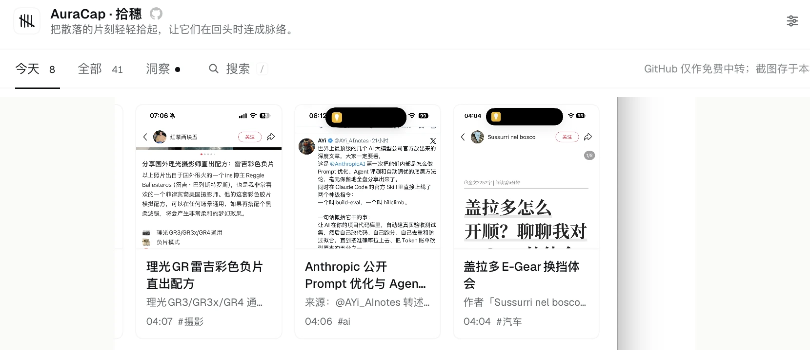

<p align="center">
  
</p>

<h1 align="center">AuraCap · 拾穗</h1>

<p align="center">
  <em>把散落的片刻捡起来，放在自己找得到的地方。</em>
</p>

> 一个长在 DeepSeek Harness 里的个人记忆插件。  
> 手机截图、相册照片、电脑文件，收进同一个地方。

---

<p align="center">
  
</p>

## 它从哪来

手机相册里总有一些截图：一段话、一张报错、一个“以后再看”的页面。

当时觉得有用，后来很少再打开。不是不想回看，是回看这件事本身太麻烦：图在相册里，理解在脑子里，要找的时候，两边都找不到。

我最早做 AuraCap，就是为了处理这个很小的缺口。

那时候的 AuraCap 不是插件，而是一条从 iPhone 到 GitHub 的路：

```text
iPhone 快捷指令
  → GitHub Release 临时队列
  → GitHub Actions 取回
  → 模型整理
  → 写入 Markdown 的 timeline / insights / summary
```

它有几个很明确的取舍：

- 不造一个新 App，顺着截图这个已经存在的习惯走；
- GitHub Release 只做临时中转，不把截图长期留在仓库里；
- 整理交给模型，结果落在用户自己的仓库；
- 除了截图，也支持录音、自部署和多个模型。

这条路是成立的，但门槛也在那里：要 fork、要配 GitHub、要理解 Actions 和 Secrets，最后得到的是一份 Markdown。  
捕捉变轻了，回看却仍然在另一个地方。

## 为什么搬进 DSH

后来我把后半段搬回了本机。

手机还是通过快捷指令拍、传；GitHub 还是只负责把图从手机送到 Mac。  
但不再跑 GitHub Actions，也不再需要一台服务器。

DSH 在本机读图、整理、保存。截图从手机进来，片刻就在侧栏里。  
捕捉和回看终于待在了同一个地方。

这不是把原项目推翻重来。  
原 AuraCap 仍然在，它解决的是“没有服务器时怎么完成一条采集链路”；  
这个插件解决的是“如果处理本来就在本机，为什么还要把数据送出去绕一圈”。

## 为什么是截图，为什么是片刻

截图是很少见的一种记录：它不需要你停下来组织语言。

看到一段话、一处报错、一个想记住的页面，按一下截图，事情就结束了。  
AuraCap 想接住的，就是这一下。

这里说的「片刻」，不是一篇笔记，也不是一个文件夹。

> 一张图、一个文件，加上模型从里面读出来的一条摘要，就是一个片刻。

同一篇文章的几张连续截图，会归成一个组；它们仍然各自是一屏，只是回看时可以放在一起。  
「拾穗」这个名字也是这个意思：不急着分类，不急着建立体系，先把落在手里的东西捡起来。

## 装上以后有什么

### 收进来

- **电脑**：拖入图片、PDF、TXT 或 Markdown，或点右上角「导入」；
- **系统截图**：点截图按钮，按 macOS 的 `⌘⇧4`，截完自动收进来；
- **手机**：通过 iOS 快捷指令，把截屏和相册照片分享进来；
- 手机快捷指令可以绑到分享菜单、`Action Button`，或辅助功能里的「轻点背面」。

### 读明白

- 图片交给 `deepseek-flash` 读图，输出 `核心内容 / 行动项 / 待确认`；
- PDF 和文本先提取正文，再交给模型整理；
- 自动生成标题、摘要、标签和线索；
- 支持重新整理、复制总结、删除单条片刻。

### 回看

- 「今天 / 全部」时间线，支持双栏和卡片视图；
- 标签可点击，直接过滤当前列表；
- 每条片刻会抽出**线索**：人物、项目、产品、主题；
- 线索浮层展示它出现过的片刻、时间线和相关洞察；
- 多屏截图可以归成一个组，显示「同组 N 屏」；
- 组详情可以合并成一条完整摘要，保留每一屏来源；合并后可拆分、重新合并；
- 组详情可显式删除整组；删除前会二次确认，会一并移除组内片刻和本地原图；
- 相关片刻会说明关联理由；
- `/` 打开全局搜索，可搜片刻、洞察、线索和组。

### 洞察

- 日洞察：每天汇总，最多每 4 小时刷新一次；
- 周迹、月迹、岁迹：周期结束后自动生成，也可以在洞察页手动生成；
- 新生成的洞察带有「依据 N 条片刻」，可以展开回看来源；
- 洞察会引用真实片段，不凭空写。

### 给 Agent 用

- 设置里可以写一段项目上下文；
- 周/月/年洞察会把它当作背景，不硬写；
- Agent 记忆默认关闭；开启后注册四个只读工具：
  - `auracap_search`
  - `auracap_about`
  - `auracap_related`
  - `auracap_recent_insights`
- Agent 能查询本地的片刻、线索、组和洞察；
- 工具只返回摘要和来源，不返回原图、文件路径或 token。

### 用量

- 记录 AuraCap 自己发起的模型调用；
- 按模型、用途、日期统计 token；
- 按 DeepSeek 官方人民币单价估算费用，含高峰/空闲时段；
- 只做估算，不代表实际账单。

## 它怎么工作

```text
iPhone 快捷指令                    Mac
      │                            │
      ▼                            ▼
私有 Release 队列  ── 轮询 ──  DSH Host
      │                            │
      └── 取回后删除队列原图 ──────┤
                                   ├─ 读图 / 总结
                                   ├─ 本地 JSON + 原图
                                   └─ 侧栏时间线
```

- GitHub 只做手机和 Mac 之间的私有中转，不运行 GitHub Actions；
- 手机上传到 `auracap-inbox` 私有仓库的 Release；
- Mac 上的插件每 60 秒轮询一次，取回后删除队列里的原图；
- 读图、总结、线索、洞察都在本机完成；
- 结果保存在 `$DSH_HOME/auracap/`。

## 继承了什么，新增了什么

表里的「早期方案」指最初给这个插件写的方案，不是原 AuraCap 已经实现的功能。

| 部分 | 原 AuraCap / 早期方案 | 当前插件 |
|---|---|---|
| 手机入口 | iOS 快捷指令 | 继承 |
| GitHub 中转 | Release + GitHub Actions | 只用 Release 队列，不跑 Actions |
| 处理位置 | GitHub Actions / 自部署后端 | 本机 DSH |
| 存储 | Markdown | 本地 JSON + 原图 |
| 音频 | 支持 | 未做 |
| 多屏归组 | 早期方案 | 已实现 |
| 时间线 UI | Markdown / 第三方工具 | DSH 侧栏 |
| 线索 / 相关片刻 | 无 | 新增 |
| 多屏合并 / 拆分 | 早期方案 | 已实现 |
| 项目上下文 / Agent 工具 | 无 | 新增 |
| 转新对话 | 早期方案 | 未做，见 [issue #2](https://github.com/massif-01/dsh-auracap/issues/2) |

## 安装

### 要求

- DeepSeek Harness `>= 0.2.1-rc.2 < 0.3.0`（当前在 `0.2.2-rc.1` 验证）；
- 默认模型路由：`deepseek-account` / `deepseek-flash`；
- 手机接入需要 GitHub 账号；
- 系统截图流程仅支持 macOS。

### 安装本地 bundle

1. 在 DSH 的插件管理里安装本目录（Install bundle），或让 DSH 指向本地 `dsh-auracap`；
2. **重启 DSH**，Host 侧插件需要重新加载；
3. 左侧栏出现 AuraCap，点开即可。

更新 Host 代码后重启 DSH；只改 Client 代码时刷新页面即可。


## 使用

侧栏点「AuraCap」打开面板。  
第一次打开时，库里没有东西，会先看到接手机的引导；也可以直接点「先在电脑上试试」，不接手机也能用。

### 收一条

不接手机也能从电脑收。

- **拖进来**：把图片、PDF、TXT 或 Markdown 拖到面板任意位置；
- **点导入**：右上角上传按钮，选择文件；
- **截图**：右上角截图按钮，按提示开始，然后用 macOS 的 `⌘⇧4` 截图，截完会自动回来；
- **手机**：用快捷指令分享截屏或照片，本机会自动从私有队列取回。

### 看一条

- 双栏视图：左边是列表，点一条，右边看整理结果；
- 卡片视图：点卡片打开详情；
- 标签可以直接点，按标签过滤当前列表；
- 详情里可以查看原图、复制总结、重新整理、删除；
- 「今天 / 全部」切换范围；
- 搜索按 `/`。

### 多屏截图

同一篇文章的连续截图会被归成一个组。

- 组卡片上会显示屏数；
- 点开组详情，可以看到每一屏；
- 可以合并成一条摘要，合并后还能拆分、重新合并；
- 单条详情里也能「与其他片刻合并」；
- 归错了就「拆开这组」；
- 「删除整组」会删除组内全部片刻和本地原图，需要二次确认。

### 看洞察

顶部切到「洞察」。

- 日洞察每天汇总；
- 周迹、月迹、岁迹在周期结束后生成，也可以手动生成；
- 洞察底部能展开「依据的片刻」，回看来源。

### 设置

右上角齿轮打开设置：

- 连接 / 断开 GitHub；
- 手动同步手机队列；
- 建立线索索引；
- 写项目上下文；
- 打开 / 关闭 Agent 读取；
- 查看用量。

Agent 读取默认关闭。打开后，Agent 才能用四个只读工具查询本地的片刻、线索、组和洞察。

### 手机怎么接

完整步骤见 [docs/shortcut-guide.md](docs/shortcut-guide.md)。  
简单说：设置里连接 GitHub → 插件创建私有收件箱 → 下载快捷指令 → AirDrop 到 iPhone → 从相册分享。


## 数据与边界

### 数据在哪里

默认数据目录：

```text
$DSH_HOME/auracap/
  items.json          片刻索引与总结
  groups.json         多屏归组与合并结果
  media/              原图留档
  digests/            日洞察
  insights/           周/月/年洞察
  memory/             线索索引、用量、项目上下文、Agent 设置
  state.json          GitHub 收件箱状态
```

`$DSH_HOME` 默认是 `~/.dsh`。

### 边界

- 原图、总结、洞察、线索索引都保存在本机；
- 读图/总结会把对应内容发送给 DeepSeek 模型，和日常对话使用同一数据边界；
- GitHub 只作为手机与本机之间的私有中转，不参与读图和总结；
- 手机上传的原图在 Mac 取回后从队列删除；
- GitHub 授权只保存在本机 DSH 凭据里，可随时在 GitHub 设置中撤销；
- 删除片刻会删除本地原图和索引；DSH 附件库按 DSH 既有策略保留；
- 删除整组会删除组内全部片刻及其本地原图，需要二次确认；
- 本机数据没有额外加密，也不自动备份；需要时请自行备份 `~/.dsh/auracap/`。

### 不给模型自动写记忆

AuraCap 不做“模型自己记住用户偏好”的自动写入。

线索从内容里抽出来；项目上下文由用户维护；Agent 工具只读，不写入、不删除、不自动记住任何东西。

## 不做什么 / 已知限制

- **不做音频**：原 AuraCap 的录音路径这一版没有搬过来；
- **不做 Markdown 导出**：当前结果保存在本地 JSON 和媒体目录里；
- **不做独立主题页、向量数据库**：先靠线索、时间、全文搜索；
- **不做自动合并**：多屏只归组，合并需要手动确认；归组本身是启发式，可能误判，可以拆开；
- **不做跨平台**：系统截图流程仅支持 macOS；Windows / Linux 手机端没有做；
- **不做 iCloud 入口、Tailscale 直传**：前者暂时不需要，后者见 issue #1；
- **不做 PAT 授权**：当前使用 GitHub Device Flow；
- **不保证 GitHub 永远可达**：队列轮询失败时会保留状态，恢复后继续；
- **扫描版 PDF 没有 OCR**：只支持能提取文字的 PDF；
- **旧数据可能需要补索引**：旧标签和旧洞察来源不会自动回填；
- **Agent 记忆默认关闭**：开启后才注册只读工具；
- **刷新是轮询**：面板平时 15 秒刷新，摘要处理中 2.5 秒，页面隐藏时 60 秒；GitHub 队列 60 秒轮询。

## 接下来

- **转新对话**：从片刻详情直接开一个新会话，见 [issue #2](https://github.com/massif-01/dsh-auracap/issues/2)；
- **Tailscale 直传**：作为 GitHub 队列之外的隐私选项，见 [issue #1](https://github.com/massif-01/dsh-auracap/issues/1)；
- **线索人工校正**：合并、改名、忽略；
- **旧数据回填**：标签和旧洞察来源；
- **项目上下文自动建议**：只生成候选，不自动写入。

## 常见问题

**手机传上来的图没有出现？**

先看设置里的 GitHub 连接状态；队列默认每 60 秒取一次。连接正常但一直没有，重新同步一次，或看设置里的错误提示。

**Agent 工具没有出现？**

确认设置里的「允许 Agent 读取 AuraCap 记忆」已经打开；打开后重新开一个对话再问。Host 代码更新过的话，需要重启 DSH。

**多屏没有归组？**

归组是启发式，标题、时间、截图尺寸和内容都会影响判断。没有自动归组时，可以在单条详情里手动「与其他片刻合并」；误归组时可以「拆开这组」。

**删除整组还能恢复吗？**

不能。删除整组会删除组内全部片刻和本地原图；这是明确的破坏性操作，界面会二次确认。

**数据怎么备份？**

复制整个 `$DSH_HOME/auracap/` 即可。它包含索引、原图和洞察；DSH 附件库不在这个目录里，按 DSH 自己的策略保留。

**为什么手机上传后，GitHub 里还有一张图？**

正常处理后，插件会从队列删除原图。如果刚上传、还没被取回，或同步失败，图会暂时留在队列里；连接恢复后继续处理。

## 开发

```bash
cd dsh-auracap
npm install
node --check index.js
node --check client.js
```

- `index.js`：Host 半边，HTTP API、模型调用、本地存储、GitHub 队列；
- `client.js`：浏览器半边，侧栏入口和面板；
- `prompts/`：读图、文本、洞察、线索、多屏合并提示词；
- `docs/`：快捷指令指南和预览图。

Host 代码改动后重启 DSH；只改 Client 时刷新页面即可。  
本地调试时可以用 `node scripts/seed-demo.mjs` 生成演示数据，`--clean` 清理。


## 来路与协议

AuraCap 最初是一个独立项目，地址是 [massif-01/AuraCap](https://github.com/massif-01/AuraCap)，以 MIT 协议发布。

这个 DSH 插件继承了它的捕捉路径、提示词思路和一些核心概念；实现、界面和本地存储是重新做的，以 **Apache License 2.0** 发布。

版权与归属声明见 [NOTICE](NOTICE)，第三方组件、字体、原 AuraCap 的 MIT 提示词来源与商标说明见 [THIRD_PARTY_NOTICES.md](THIRD_PARTY_NOTICES.md)。

Apache 2.0 包含明确的专利授权；但它只授予代码版权与专利许可，不授予 AuraCap、DeepSeek Harness、GitHub 等名称或标识的商标权。
