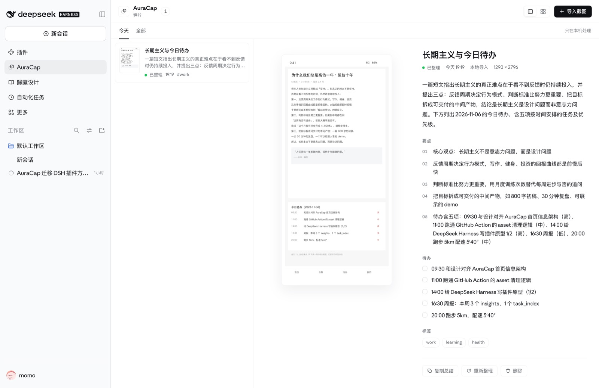
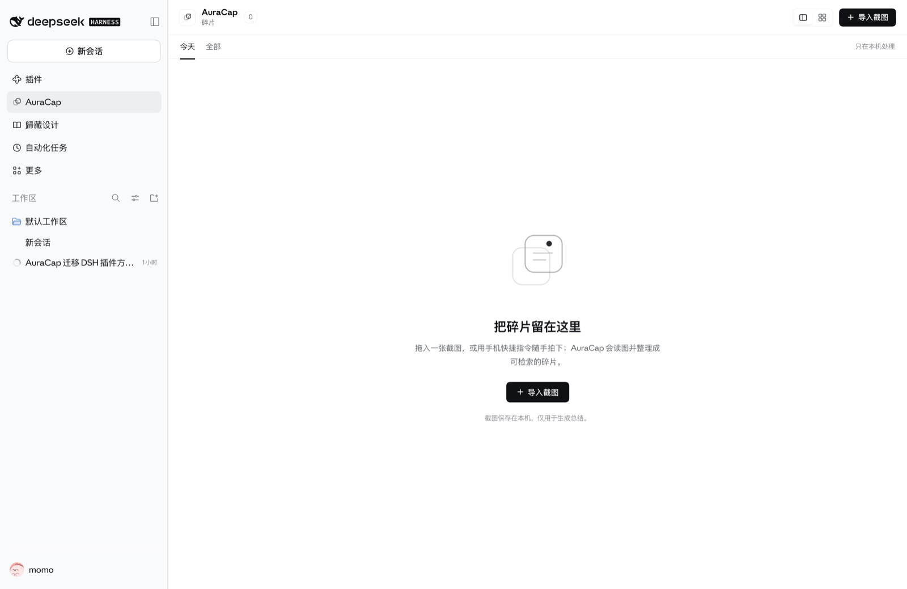
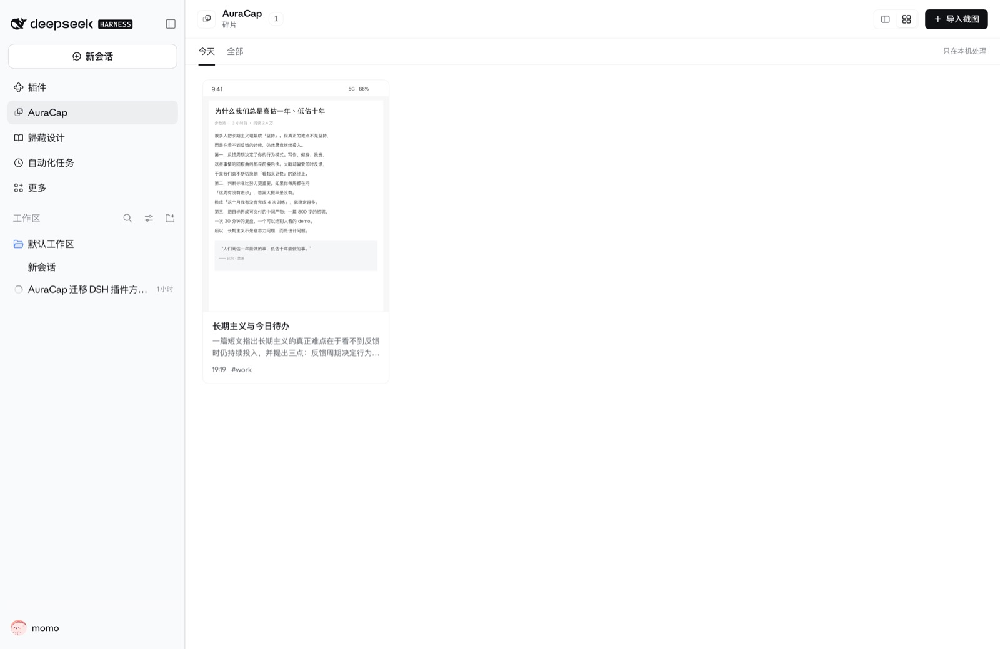

# AuraCap for DeepSeek Harness

把手机截图收进 DeepSeek Harness，用模型读图并整理成可检索的碎片笔记。

> **S0 状态**：当前版本只做本机拖拽 + 读图总结 + 侧栏浏览，验证核心链路。
> GitHub 队列、Tailscale 直传、日报/周报在后续里程碑里。



## 现在能做什么

- 把截图拖进 AuraCap 面板，或点「导入截图」选择文件；
- 插件在本机调用 DSH 的视觉模型，输出标题、总结、要点、待办、标签；
- 侧栏入口 + 双栏 / 卡片两种视图，列表默认展示大缩略图；
- 数据保存在本机，可随时删除单条碎片；
- 全程不经过相册、云盘或第三方存储。

| 空状态 | 卡片视图 |
|---|---|
|  |  |

## 环境要求

- DeepSeek Harness `>= 0.2.1-rc.2 < 0.3.0`（当前在 `0.2.2-rc.1` 上验证）；
- 一个支持图片输入的模型路由。默认使用 `deepseek-account` / `deepseek-flash`；
- 模型调用会在 **DSH 进程内** 完成，不需要额外 API key。

## 安装

本仓库目前以本地 bundle 形式安装：

1. 让 DSH 安装本目录（Plugin Manager 的 Install bundle，或 `plugin_manager install_bundle` 指向本目录）；
2. **重启一次 DSH**（Host 侧插件更新需要重新加载）；
3. 左侧栏出现 `AuraCap` 图标，点开即可使用。

> 安装/更新 Host 插件后都需要重启 DSH；Client 侧改动刷新页面即可。

## 使用

1. 把一张截图拖进面板（支持 PNG / JPEG / WebP / GIF，单张 ≤ 30MB）；
2. 条目先以「正在读图…」出现，几秒后变成「已整理」；
3. 左侧列表选择条目，右侧查看原图、总结、要点、待办、标签；
4. 顶部可切换「双栏 / 卡片」，默认首屏是「今天」；
5. 详情页可复制总结、重新整理、删除。

## 数据与隐私

- 数据目录：`$DSH_HOME/auracap/`
  - `items.json`：条目索引与总结；
  - `media/`：原图留档；
- 图片同时以内容寻址方式存入 DSH 的附件库，用于模型读图；
- 截图只在本机处理，发送给模型的部分与日常对话同一数据边界；
- 删除条目会删除原图与索引，附件库中的对象按 DSH 既有策略保留（不自动回收）。

## 实现

```
dsh-auracap/
  index.js            Host：HTTP API、读图总结、本地存储
  client.js           Client：侧栏入口 + 主面板（React，无构建步骤）
  prompts/            截图提取提示词（基于 AuraCap，MIT）
  locale/             插件元数据（中文 / English）
  docs/               README 截图
```

- 读图：`ctx.attachments.saveImage` → `ctx.llm.stream`（image block + JSON 约束）；
- 路由：`/auracap/api/{items,media,ingest}`，同源访问；
- 状态：`items.json` 原子写入；条目状态 `summarizing / ready / failed`；
- 面板：`sidebar.panellist` + `main`（keyed），只用 DSH 主题 token，无 iframe。

## 路线图

- **M1** GitHub Release 队列：OAuth 一键授权、自动建私有仓库与 release、手机快捷指令上传、轮询消费；
- **M2** Tailscale 直传（opt-in，最高隐私）；
- **M3** 日报 / 周报（面板内生成）；
- **M4** 归组 / 合并、搜索、i18n 完善；
- **V1.1** DSH Settings 入口、Shortcut 的 iCloud 分享链接。

## 致谢

- 提示词与产品思路来自 [AuraCap](https://github.com/massif-01/AuraCap)（MIT）；
- 插件机制参考 DeepSeek Harness 的 Cordis 插件规范。

## License

MIT
