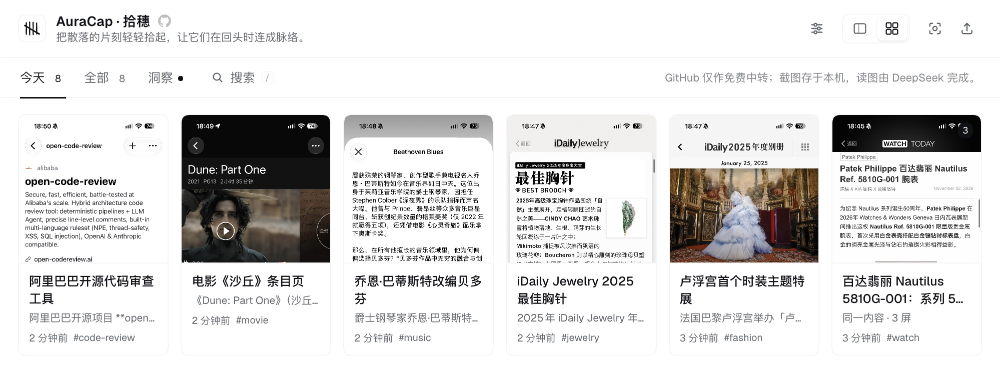
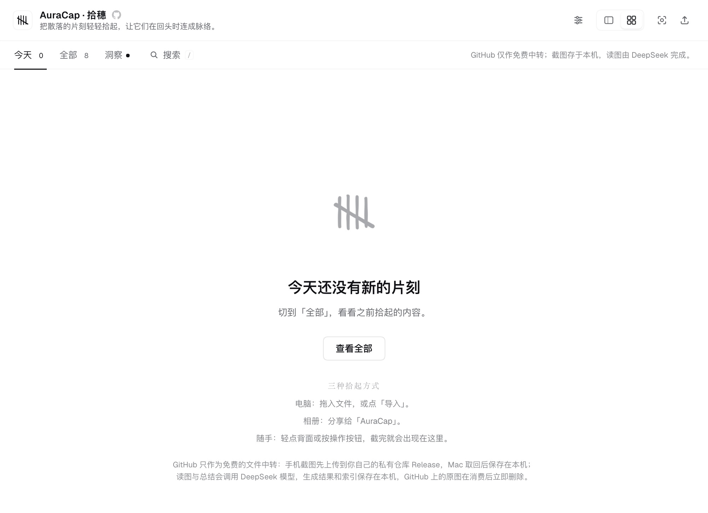
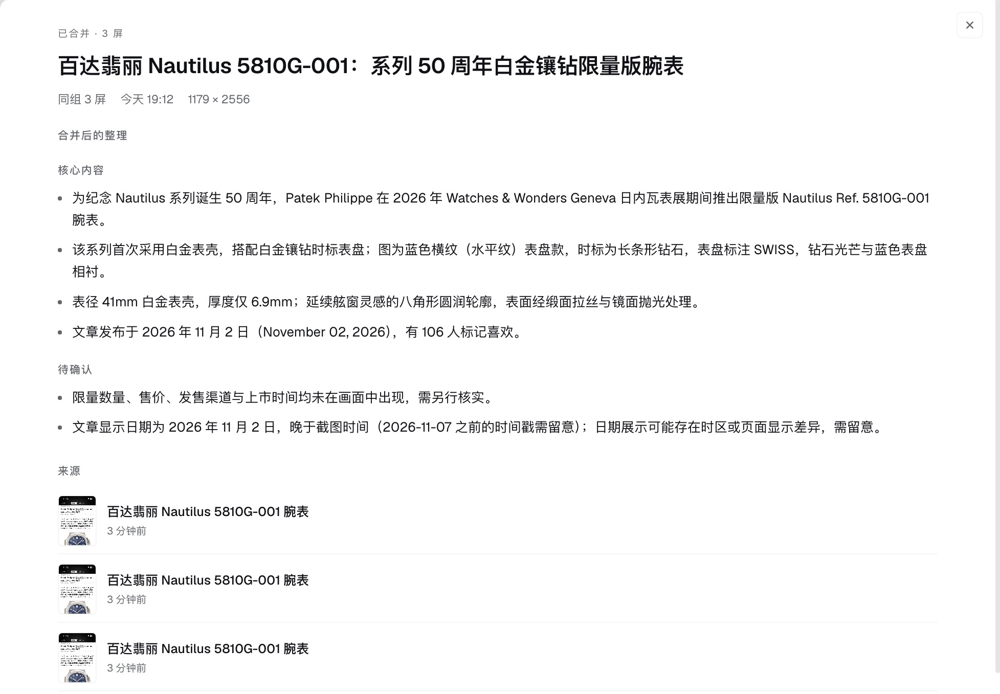
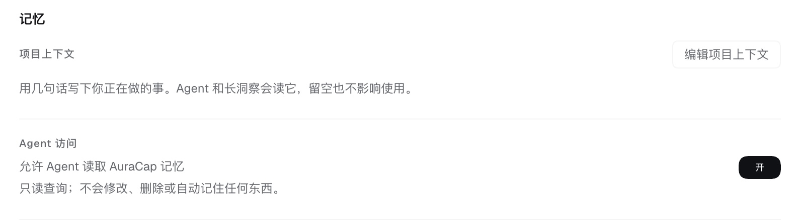

<p align="center">
  
</p>

<h1 align="center">AuraCap · 拾穗</h1>

<p align="center">
  <em>把散落的片刻轻轻拾起，让它们在回头时连成脉络。</em>
</p>

<p align="center">
  一个长在 DeepSeek Harness 里的个人记忆插件。
</p>

<p align="center">
  
</p>

<p align="center">
  <sub>今天拾起的片刻，和一篇被归在一起的三屏记录</sub>
</p>

## 一件事

手机相册里总有一些截图：一段话、一张报错、一个“以后再看”的页面。

当时觉得有用，后来很少再打开。不是不想回看，是回看这件事本身太麻烦：图在相册里，理解在脑子里，要找的时候，两边都找不到。

AuraCap 只做一件事：**让截图在拾起之后，真的还能被找回来。**

## 从哪来

AuraCap 最早不是一个插件。

它是一条从 iPhone 到 GitHub 的路：快捷指令把截图送进私有 Release，GitHub Actions 取回、交给模型整理，再写进 Markdown 的 timeline、insights 和 summary。

那条路是成立的，但要 fork、要配 Actions、要理解 Secrets。捕捉变轻了，回看却还在另一个地方。

现在这版把后半段搬回了本机：

- 手机还是通过快捷指令上传；
- GitHub 只负责把图从手机送到 Mac；
- 读图、总结、搜索、洞察都在本机完成；
- 回看和捕捉，终于待在同一个侧栏里。

## 它能做什么

- **拾起**：拖入图片、PDF、TXT、Markdown，或点右上角导入；macOS 截图和 iOS 快捷指令也可以。
- **读懂**：图片交给模型读，生成标题、核心内容、行动项、标签和线索。
- **回看**：今天 / 全部时间线，双栏或卡片；标签、线索、相关片刻都能点。
- **多屏**：同一篇文章的连续截图会归组，可以合并成一条摘要，也可以拆开或重新合并。
- **归纳**：日洞察、周迹、月迹、岁迹，带真实来源。
- **交给 Agent**：写一段项目上下文；开启后，Agent 可以只读查询这些片刻。

## 界面

<table>
  <tr>
    <td width="50%" align="center">
      <br>
      <sub>还没有新的片刻时</sub>
    </td>
    <td width="50%" align="center">
      <br>
      <sub>多屏记录可以合在一起看</sub>
    </td>
  </tr>
  <tr>
    <td align="center">
      <br>
      <sub>项目上下文，和 Agent 的读取开关</sub>
    </td>
  </tr>
</table>

## 开始使用

### 安装

需要 DeepSeek Harness `>= 0.2.1-rc.2 < 0.3.0`。

在 DSH 的插件管理里安装本目录（Install bundle），然后重启 DSH。左侧栏出现 AuraCap，点开就能用。

### 第一次打开

AuraCap 会先带你接手机；不接手机也可以直接用电脑导入。跟着面板里的引导走就好。

## 数据

所有数据默认放在：

```text
~/.dsh/auracap/
```

- 原图、总结、洞察、线索索引都在本机；
- 读图和总结会把对应内容发给 DeepSeek 模型，和日常对话使用同一数据边界；
- GitHub 只做手机到 Mac 的私有中转，取回后删除队列里的原图；
- 本机数据没有额外加密，也不会自动备份；需要时请自行备份上面的目录；
- 删除片刻或整组，会删除本地原图。

## 边界

- 多屏归组是启发式的，可能误判；不会自动合并，可以手动拆开；
- 还没有做：音频、Markdown 导出、Tailscale 直传、Windows / Linux；
- Agent 记忆默认关闭，只读，不会自动写入。

## 来路

AuraCap 最初是一个独立项目：[massif-01/AuraCap](https://github.com/massif-01/AuraCap)。

它解决的是“没有服务器时，怎么把手机上的截图送过来”；这个插件解决的是“处理本来就在本机时，为什么还要把数据送出去绕一圈”。

原项目以 MIT 协议发布，这个插件以 Apache License 2.0 发布。版权与第三方说明见 [NOTICE](NOTICE) 和 [THIRD_PARTY_NOTICES.md](THIRD_PARTY_NOTICES.md)。
